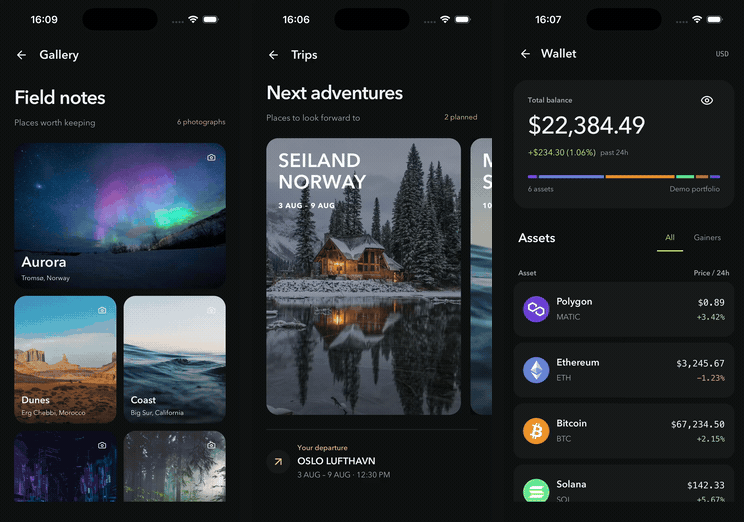
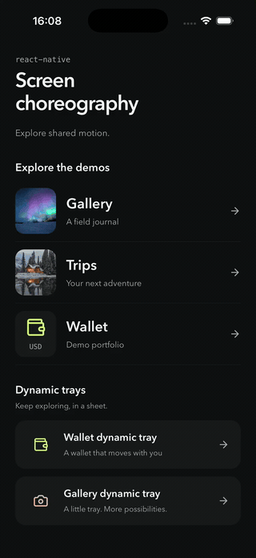
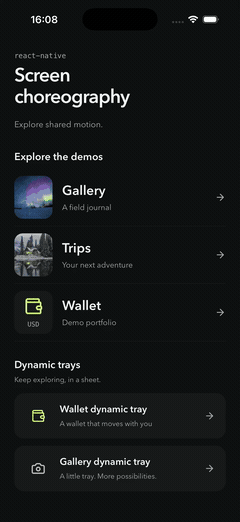

# react-native-screen-choreography

**Shared elements. Connected screens. Dynamic trays.**

Move real content between React Native screens and resizable trays without losing component state. Coordinate shared elements and supporting motion with one animation progress value.

[Documentation](https://screen-choreography.dev) · [Get started](https://screen-choreography.dev/guide/installation.html) · [Examples](https://screen-choreography.dev/examples.html) · [Dynamic trays](docs/guide/dynamic-trays.md)

<p align="center">
  
</p>

## What you can build

- **Shared element transitions:** move several elements together, with one live content subtree per shared element. React state and context stay with the original owner.
- **Coordinated motion:** drive supporting content, reveals, and custom transitions from the same progress value.
- **Interactive Back:** connect your own gesture to transition progress, including cancellation. Native-stack swipe progress is not connected automatically.
- **Dynamic trays:** build flows inside a sheet that resizes with its content, expands to full screen, responds to the keyboard, and preserves forms and scroll position on Back.

Use React Navigation or Expo Router for screen transitions. Trays have their own typed stack and can run without either navigation library.

## Dynamic trays

A tray keeps a flow inside the current screen. Share elements between steps, let the sheet fit each view, and return to a previous step without rebuilding its state.

The example app includes two flows:

- **Gallery Plus:** shared photo and button elements move through plan selection and preview as the tray resizes.
- **Wallet:** change a payment draft from 25 to 250, open the full-screen recipient list, and go Back with 250 preserved.

<p align="center">
  <a href="docs/media/gallery-tray.mp4"></a>
  &nbsp;
  <a href="docs/media/wallet-tray.mp4"></a>
</p>

Trays use the optional `/tray` entry with Software Mansion bottom sheets and Keyboard Controller. Those dependencies are only required when using trays.

[Build your first tray](docs/guide/dynamic-trays.md) · [Tray installation](docs/guide/installation.md#dynamic-trays-without-a-router) · [Gallery source](examples/shared/tray/GalleryPlusTray.tsx) · [Wallet source](examples/shared/tray/TrayDemo.tsx)

## Get started

```sh
npm install react-native-screen-choreography
```

The library includes native code and requires peer dependencies and a native rebuild. Choose the setup for your app:

- [React Navigation](docs/guide/installation.md#react-navigation)
- [Expo Router](docs/guide/installation.md#expo-router)
- [Dynamic trays without a router](docs/guide/installation.md#dynamic-trays-without-a-router)

**Requirements:** iOS or Android, React Native ≥0.81 with the New Architecture / Fabric, React ≥18, Reanimated ≥4, Worklets ≥0.8.3, and Teleport ≥1.2.2. Choose mutually compatible versions; these peer ranges are not a full tested compatibility matrix. Expo requires a development build; Expo Go is not supported.

The bare example uses React Native 0.83; the Expo Router example uses Expo SDK 57. See the [installation guide](docs/guide/installation.md) for navigation dependencies, Babel configuration, and native setup.

> **Pre-1.0:** minor versions can introduce breaking changes. Check the [release notes](https://github.com/DorianMazur/react-native-screen-choreography/releases) when upgrading.

## Render once, share between screens

The source renders the content. The destination declares an empty, measurable target. The library moves the same native subtree through an overlay into that target using `react-native-teleport`.

```tsx
import { SharedElement } from 'react-native-screen-choreography';

// Source screen: render content once.
<SharedElement id="hero" groupId="photo.aurora" style={styles.tile}>
  <PhotoHero />
</SharedElement>;

// Destination screen: reserve its receiving bounds.
<SharedElement.Target id="hero" groupId="photo.aurora" style={styles.hero} />;
```

Pair both endpoints with the same `id` and `groupId`. The owner screen must remain mounted. Wrap routes in `ChoreographyScreen` and navigate with that group; the [complete two-screen example](docs/guide/quick-start.md) covers provider placement, navigator configuration, and Back. For Expo Router, use the exports from `react-native-screen-choreography/expo-router`.

## Explore the examples

Both apps share the Gallery, Trips, Wallet, and dynamic tray demos, including their `defineTransition` definitions:

- [React Navigation example](examples/react-navigation/README.md) — bare React Native setup for iOS and Android.
- [Expo Router example](examples/expo-router/README.md) — native development-build setup.
- [Shared demo source](examples/shared) — screens, trays, and transition definitions used by both apps.

## Documentation

| Build a feature                                    | Reference                                        |
| -------------------------------------------------- | ------------------------------------------------ |
| [Your first transition](docs/guide/quick-start.md) | [Components](docs/api/components.md)             |
| [Transition recipes](docs/guide/transitions.md)    | [Transitions](docs/api/transitions.md)           |
| [Interactive Back](docs/guide/interactive-back.md) | [Navigation](docs/api/navigation.md)             |
| [Dynamic trays](docs/guide/dynamic-trays.md)       | [Hooks and utilities](docs/api/hooks.md)         |
| [Readiness and loading](docs/guide/readiness.md)   | [Troubleshooting](docs/guide/troubleshooting.md) |

For contributors: [runtime architecture](docs/architecture.md) · [contributing](CONTRIBUTING.md).

## License

[MIT](LICENSE)
